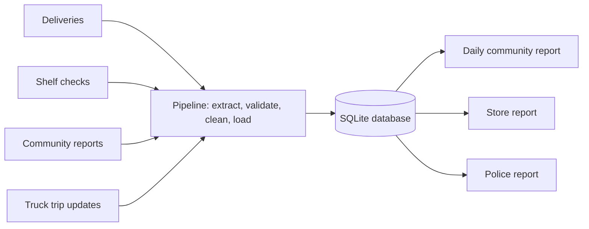

# SafeShelf Tembisa

**A data pipeline that helps communities keep expired and spoiled food off supermarket shelves, and keeps delivery trucks safe.**

> 🚧 **Status: planning.** See the [project plan](docs/PLAN.md), the [user stories](docs/USER_STORIES.md) and the project board (Projects tab).

## The problem

In Tembisa, residents have raised concerns that some supermarkets and spaza shops sell food that has expired or gone bad. That includes bread, drinks and other everyday essentials near the end of their shelf life. Delivery trucks bringing stock into the area are also targets for hijackings.

## The idea

Track everyday essentials **from the delivery truck to the shelf**:

- **Stores** record deliveries with batch numbers and expiry dates.
- **Community committees** record regular shelf checks.
- **Residents** report problems anonymously.
- **Trucks** send trip updates that **only the police** can see.

A data pipeline checks and cleans this data, loads it into a SQL database and produces daily alerts:

- expired food still on shelves
- essentials about to expire
- suppliers delivering near-expiry stock
- a store scoreboard
- a separate police-only report of delayed trucks and unexpected stops



## How to run

You need Python 3.10 or newer. The pipeline will only use Python's standard library; pytest is for the tests.

```bash
git clone https://github.com/BaneleChakuma/safeshelf-tembisa.git
cd safeshelf-tembisa
python3 -m venv .venv
source .venv/bin/activate
pip install -r requirements.txt

python -m pytest                      # run the tests
```

On Ubuntu or Pop!_OS, if `python3 -m venv` complains, run `sudo apt install python3-venv` first.
Run `source .venv/bin/activate` again in every new terminal.

If `pip install` ends with `from versions: none`, pip couldn't download from PyPI, where Python
packages come from. Some networks block it: try another connection, such as your phone's
hotspot. `pip config list` also shows whether one of pip's settings tells it not to use PyPI.

> **Tip: installing without internet.** Download the package files (`.whl`) on a connection
> that works, put them in one folder, and install from that folder:
> `pip install --no-index --find-links ~/Downloads/safeshelf-wheels -r requirements.txt`

## Who it's for

| User | What SafeShelf gives them |
|---|---|
| Community member | Which stores are safe, plus a way to report problems anonymously |
| Committee member | A simple way to record shelf checks, and a daily list of problems to follow up |
| Store manager | Proof of what was delivered, and warnings before stock expires |
| Supplier / driver | Fair delivery records; truck locations kept private |
| Police | Early warning when a delivery truck is late or stops unexpectedly |

## Tech stack

Python 3 · SQLite / SQL · pytest · GitHub Actions · GitHub Projects

## Project docs

| Document | What's in it |
|---|---|
| [Project plan](docs/PLAN.md) | Problem, goals, how it works, timeline, risks |
| [User stories](docs/USER_STORIES.md) | Every story with acceptance criteria, grouped by iteration |
| [Data model](docs/DATA_MODEL.md) | ER diagram, tables, keys and constraints |
| [Data governance](docs/DATA_GOVERNANCE.md) | Privacy (POPIA): who can see what, and for how long |

## About the data

This project uses **simulated data**. Store names are made up and don't refer to any real business.

---

Built by Banele Chakuma as a Data Engineering elective project.
