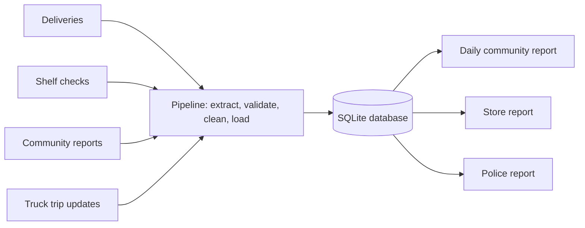

# SafeShelf Tembisa

[](https://github.com/BaneleChakuma/safeshelf-tembisa/actions/workflows/pipeline.yml)

**A data pipeline that helps communities keep expired and spoiled food off supermarket shelves, and keeps delivery trucks safe.**

> 🚧 **Status: in progress.** The pipeline runs end to end on simulated data. See the [project plan](docs/PLAN.md), the [user stories](docs/USER_STORIES.md) and the project board (Projects tab).

## The problem

In Tembisa, residents have raised concerns that some supermarkets and spaza shops sell food that has expired or gone bad. That includes bread, drinks and other everyday essentials near the end of their shelf life. Delivery trucks bringing stock into the area are also targets for hijackings.

## The idea

Track everyday essentials **from the delivery truck to the shelf**:

- **Stores** record deliveries with batch numbers and expiry dates.
- **Community committees** record regular shelf checks.
- **Residents** report problems anonymously.
- **Trucks** send trip updates that **only the police** can see.

A data pipeline checks and cleans this data, loads it into a SQL database and produces daily alerts:

- expired food still on shelves
- essentials about to expire
- suppliers delivering near-expiry stock
- a store scoreboard
- a separate police-only report of delayed trucks and unexpected stops



## How to run

You need Python 3.10 or newer. The pipeline will only use Python's standard library; pytest is for the tests.

```bash
git clone https://github.com/BaneleChakuma/safeshelf-tembisa.git
cd safeshelf-tembisa
python3 -m venv .venv
source .venv/bin/activate
pip install -r requirements.txt

python -m pytest                                    # run the tests
PYTHONPATH=src python -m safeshelf run --days 30    # simulate 30 days and run every step
```

`run` simulates the data, builds the database in `data/safeshelf.db`, loads the files in
`data/incoming/` (bad rows go to `data/rejected/` with the reason), removes truck locations older
than 30 days and writes the reports to `reports/`. It ends with a short summary:

```
Files processed: 180
Rows loaded:     2600
Rows rejected:   141
Police alerts:   0
```

| Option | What it does |
|---|---|
| `--days N` | Simulate N days first, ending on `--today`. Leave it out to process only the files already in `data/incoming/` |
| `--seed S` | The same seed always gives the same data (default: 42) |
| `--today YYYY-MM-DD` | The day to report on (default: today) |
| `--root FOLDER` | The folder that holds `data/` and `reports/` (default: the project folder) |

Running it again only loads new files. To start the database again from every file in
`data/incoming/`, run `PYTHONPATH=src python -m safeshelf rebuild`.

## Automation

GitHub Actions ([`.github/workflows/pipeline.yml`](.github/workflows/pipeline.yml)) runs the tests on
every push and pull request, on Python 3.10 and 3.12. Every morning at 06:00 it also runs the
pipeline on 30 days of simulated data and uploads the daily report as an artifact called
`daily-report`. To run it yourself, open the Actions tab, choose *Pipeline* and press *Run workflow*.
The police report is never uploaded: truck locations are for the police only.

On Ubuntu or Pop!_OS, if `python3 -m venv` complains, run `sudo apt install python3-venv` first.
Run `source .venv/bin/activate` again in every new terminal.

If `pip install` ends with `from versions: none`, pip couldn't download from PyPI, where Python
packages come from. Some networks block it: try another connection, such as your phone's
hotspot. `pip config list` also shows whether one of pip's settings tells it not to use PyPI.

> **Tip: installing without internet.** Download the package files (`.whl`) on a connection
> that works, put them in one folder, and install from that folder:
> `pip install --no-index --find-links ~/Downloads/safeshelf-wheels -r requirements.txt`

## Simulating data

There's no real data feed yet, so a simulator writes realistic daily files -- deliveries, shelf
checks, community reports and truck trips -- into `data/incoming/`, with deliberate problems
(expired items, misspelled products, delayed trucks and so on) for the pipeline to catch:

```bash
PYTHONPATH=src python -m safeshelf.simulate --days 30 --seed 42
```

The same seed always produces the same files. `--start YYYY-MM-DD` picks the first simulated
day (default: ending today); `--root FOLDER` points it at a different project folder.

## Who it's for

| User | What SafeShelf gives them |
|---|---|
| Community member | Which stores are safe, plus a way to report problems anonymously |
| Committee member | A simple way to record shelf checks, and a daily list of problems to follow up |
| Store manager | Proof of what was delivered, and warnings before stock expires |
| Supplier / driver | Fair delivery records; truck locations kept private |
| Police | Early warning when a delivery truck is late or stops unexpectedly |

## Tech stack

Python 3 · SQLite / SQL · pytest · GitHub Actions · GitHub Projects

## Project structure

| Folder | What's in it |
|---|---|
| `docs/` | The project plan, user stories, data model, governance and testing docs |
| `data/reference/` | Reference lists the pipeline checks data against: stores, suppliers, products |
| `data/templates/` | Example CSV files showing the format each input file should follow |
| `data/incoming/`, `data/rejected/` | Created by the pipeline at runtime (accepted and rejected input files); not committed to Git |
| `reports/` | Created by the pipeline: the daily report, and the police report in `reports/police/`; not committed to Git |
| `sql/` | `schema.sql` (the database structure) and `sql/reports/` (the queries behind each report) |
| `src/safeshelf/` | The pipeline's Python package: extract, validate, clean, load, reports |
| `tests/` | Unit, acceptance and end-to-end tests — see [the testing guide](docs/TESTING.md) |
| `setup/` | One-off scripts for setting up the GitHub repo and project board |

## Project docs

| Document | What's in it |
|---|---|
| [Project plan](docs/PLAN.md) | Problem, goals, how it works, timeline, risks |
| [User stories](docs/USER_STORIES.md) | Every story with acceptance criteria, grouped by iteration |
| [Data model](docs/DATA_MODEL.md) | ER diagram, tables, keys and constraints |
| [Data governance](docs/DATA_GOVERNANCE.md) | Privacy (POPIA): who can see what, and for how long |
| [Testing](docs/TESTING.md) | How to run the tests, and what each one expects from the code |

## About the data

This project uses **simulated data**. Store names are made up and don't refer to any real business.

---

Built by Banele Chakuma as a Data Engineering elective project.
