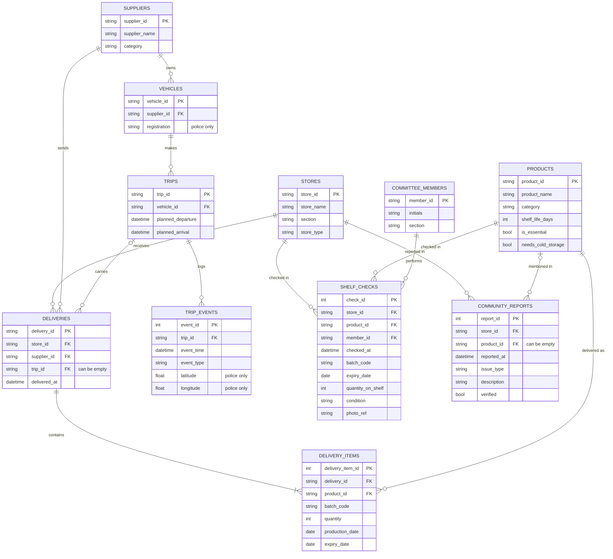

# Data model

This is the planned database design for SafeShelf. Each entity becomes a table, and each relationship becomes a foreign key on the "many" side.

## Relationships

| Relationship | Cardinality | Foreign key |
|---|---|---|
| A store receives deliveries | 1 : M | `deliveries.store_id` |
| A supplier sends deliveries | 1 : M | `deliveries.supplier_id` |
| A supplier owns vehicles | 1 : M | `vehicles.supplier_id` |
| A vehicle makes trips | 1 : M | `trips.vehicle_id` |
| A trip carries deliveries (one truck can serve several stores) | 1 : M (optional) | `deliveries.trip_id` |
| A trip logs events | 1 : M | `trip_events.trip_id` |
| A delivery contains items | 1 : M | `delivery_items.delivery_id` |
| A product is delivered as items | 1 : M | `delivery_items.product_id` |
| A store / product / committee member appears in shelf checks | 1 : M each | `shelf_checks.store_id`, `.product_id`, `.member_id` |
| A store is reported in community reports | 1 : M | `community_reports.store_id` |
| A product is mentioned in community reports | 1 : M (optional) | `community_reports.product_id` |

## Constraints (rules the database itself enforces)

| Table | Rule |
|---|---|
| `products` | `shelf_life_days > 0` |
| `delivery_items` | `quantity > 0` and `expiry_date >= production_date` |
| `shelf_checks` | `condition IN ('OK', 'EXPIRED', 'MOULDY', 'DAMAGED_PACKAGING', 'SWOLLEN', 'NOT_COLD')` |
| `community_reports` | `issue_type IN ('EXPIRED', 'SPOILED', 'BAD_SMELL', 'SICK_AFTER_EATING', 'OTHER')`; `verified` defaults to 0 |
| `trip_events` | `event_type IN ('DEPARTED', 'CHECKPOINT', 'STOPPED', 'ARRIVED')`; `latitude` and `longitude` are emptied after 30 days (POPIA) |
| All tables | Primary key on the ID; foreign keys switched on with `PRAGMA foreign_keys = ON` |

## Monitoring table

`pipeline_runs` keeps a record of every file the pipeline processes, so files are never loaded twice and the run can be monitored:

| Column | Meaning |
|---|---|
| `run_id` (PK) | One row per processed file |
| `file_name` (unique) | Name of the incoming file |
| `processed_at` | When it was processed |
| `rows_read`, `rows_loaded`, `rows_rejected` | How much data went through, and how much was rejected |

## Views

`sql/schema.sql` also creates one view per audience: `community_view`, `committee_view`,
`store_view` and `police_view`. Each leaves out what its audience may not see, and each report
is built from one of them. [DATA_GOVERNANCE.md](DATA_GOVERNANCE.md) lists what's in each view.
