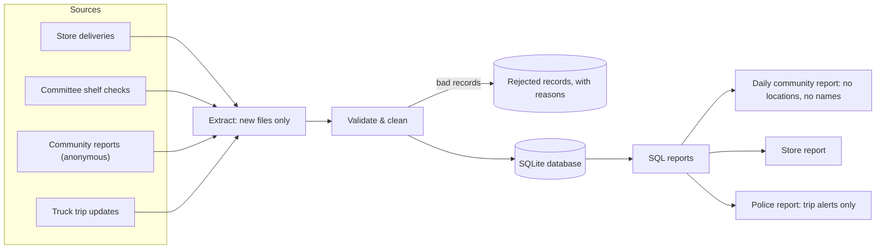

# SafeShelf Tembisa: Project Plan

> Data Engineering elective project by Banele Chakuma · October to November 2026

## 1. The problem

In Tembisa, residents have raised concerns that some supermarkets and spaza shops sell food that has expired or gone bad. This includes bread, drinks and other everyday essentials that are past, or close to, the end of their shelf life. People often only find out after they've bought it. When something does go wrong, there's no record of where the food came from, when it was delivered or how long it sat on the shelf.

There's a second problem: delivery trucks bringing stock into the area are targets for hijackings. Any system that tracks deliveries must not make that worse.

## 2. The idea

Track everyday essentials **from the delivery truck to the shelf**, and turn that information into daily alerts the community can act on.

- **Stores** record each delivery: which products, batch numbers, production dates and expiry dates.
- **Community food-safety committees** do regular shelf checks and record what they find.
- **Residents** can report problems anonymously.
- **Delivery trucks** send trip updates that **only the police** can see, so delays or unexpected stops can be followed up quickly.

A **data pipeline** collects all of this, checks and cleans it, stores it in a relational database and produces reports.

## 3. Goals

By the end of the elective, SafeShelf should:

1. Load deliveries, shelf checks, community reports and trip updates into a well-designed SQL database.
2. Reject bad or incomplete data automatically, with a reason for every rejected record.
3. Produce a daily report covering:
   - expired food still on shelves
   - essentials about to expire
   - suppliers delivering near-expiry stock
   - a store scoreboard
4. Produce a separate, **police-only** report of delayed trucks and unexpected stops.
5. Protect personal information and truck locations (POPIA).
6. Run with one command, with automated tests, and run once a day on GitHub Actions.

### Not in scope (for now)

- A mobile app or website. Data comes in as CSV files, and capturing it with a phone form is a stretch goal.
- Real GPS devices or real store data. The project uses **simulated data with made-up stores**.
- Enforcement. SafeShelf collects evidence; acting on it is up to committees, stores, the municipality and the police.

## 4. Who it's for

| User | What they need |
|---|---|
| Community member | To know which stores are safe, and to report problems without fear |
| Committee member | To record shelf checks and get a daily list of problems to follow up |
| Store manager | Proof of what was delivered, and a warning before stock expires |
| Supplier / driver | A fair record of each delivery, with the truck's location kept private |
| Police (SAPS) | An early warning when a delivery truck is late or stops unexpectedly |
| Data engineer (me) | A reliable, tested, automated pipeline |

## 5. How it works

The pipeline has five steps:

1. **Extract**: read new CSV files from `data/incoming/`. Each processed file is recorded in a `pipeline_runs` table, so nothing is ever loaded twice.
2. **Validate**: check every record against the data quality rules below. Bad records go to `data/rejected/` with the reason.
3. **Clean**: standardise names and dates, match product aliases (for example, "white bread 700g" and "BREAD WHITE" become the same product) and remove duplicates.
4. **Load**: insert into SQLite in foreign-key order (stores and products first, then deliveries, then delivery items), inside a transaction.
5. **Report**: run the SQL report queries and write the daily reports.

### Data quality rules

| Rule | Example of a record that gets rejected |
|---|---|
| Required fields are present | A shelf check with no store |
| The store exists | A delivery to store `ST999` |
| The product exists (after alias matching) | "Brd" that can't be matched to a product |
| Dates are valid and not in the future | Expiry date `31-02-2026`, or a check dated next week |
| Expiry date is on or after the production date | Produced 5 Oct, expires 1 Oct |
| Quantity is more than 0 | Quantity `-5` |
| Condition is an allowed value | Condition `badish` |

## 6. The data

There's no real data feed yet, so a **simulator** generates 30 days of realistic data from a fixed seed (the same seed always gives the same data). It deliberately includes problems the pipeline must catch: expired stock on shelves, deliveries that are already close to expiry, typos, missing values and delayed trucks. Store names are made up, and real Tembisa section names are used only for realism.

The database has these tables (full ER diagram in [DATA_MODEL.md](DATA_MODEL.md)):

| Table | What it holds |
|---|---|
| `stores`, `suppliers`, `products` | Reference data. Products include shelf life and an "essential" flag |
| `deliveries`, `delivery_items` | What arrived, when, with batch, production and expiry dates |
| `committee_members`, `shelf_checks` | Who checked what, when, and the condition found |
| `community_reports` | Anonymous reports, marked verified once a committee member confirms them |
| `vehicles`, `trips`, `trip_events` | Truck trips and location updates (**police only**) |
| `pipeline_runs` | Monitoring: files processed, rows loaded and rows rejected |

## 7. Reports and alerts

| Report | Who sees it | Question it answers |
|---|---|---|
| Expired food on shelves | Committee, stores | What must be removed today? |
| Essentials about to expire | Stores, committee | What should be discounted or removed in the next 2 days? |
| Near-expiry deliveries by supplier | Committee, stores | Which suppliers deliver stock that's already old? |
| Store scoreboard (last 30 days) | Community | Where is food checked and safe? |
| Delivery trip alerts | **Police only** | Which trucks are late or stopped unexpectedly? |

## 8. Security and privacy (POPIA)

- **Truck locations go only to the police.** They're never in community or store reports, and they're deleted after 30 days.
- **Community reports are anonymous.** No names, phone numbers or ID numbers are stored.
- **Committee members** are recorded by initials and section only.
- **The scoreboard uses verified findings only**, so stores aren't judged on rumours.
- **This repository only contains simulated data.**

Details are in [DATA_GOVERNANCE.md](DATA_GOVERNANCE.md).

## 9. Tech stack

| Tool | Why |
|---|---|
| Python 3 | The pipeline code: extract, validate, clean, load, report |
| SQLite + SQL | A relational database with primary and foreign keys; no server needed, and the same SQL as the course |
| pytest | Automated tests |
| GitHub Actions | Runs the tests on every push and the pipeline once a day |
| GitHub Projects | The issue board to plan and track the work |
| Mermaid | Diagrams in the docs, which GitHub draws automatically |

Stretch: MySQL or PostgreSQL in Docker, a Streamlit dashboard, Google Forms for phone data capture.

## 10. Timeline

Each iteration is a GitHub milestone, and every issue belongs to one. The full list of user stories is in [USER_STORIES.md](USER_STORIES.md).

| Iteration | Dates | Goal | Issues |
|---|---|---|---|
| 0: Plan and set up | 15 to 18 Oct | Board, repo structure, Python environment | 2 |
| 1-4: Data model, ingest/clean, reports and alerts, delivery safety and privacy | 20 to 23 Oct | ER diagram and schema; simulator, extract, validate, clean, load; SQL reports; police alerts, role-based views, governance | 20 |
| 5: Automate, test and present | 23 to 29 Nov | One command, tests, GitHub Actions, demo | 4 |
| Stretch goals | After that | Dashboard, phone data capture, MySQL/PostgreSQL | 3 |

Iterations 1 to 4 were originally spread from 19 Oct to 22 Nov, but were combined into one milestone due 23 Oct to match a moved deadline. Iteration 5's milestone is unchanged for now.

If the elective deadline is different, change the dates in `setup/backlog.json` before running the setup script, or edit the milestones on GitHub afterwards.

## 11. How I'll work

- **Board:** every issue starts in *Todo*, moves to *In Progress* when I start it, and to *Done* when it's merged.
- **One branch per issue**, for example `git switch -c 6-data-simulator`.
- **Pull requests** say `Closes #6` so the issue closes automatically when merged.
- **Definition of Done:**
  - the acceptance criteria are ticked
  - the tests pass
  - the docs are updated
  - the change is merged into `main`
- **End of each iteration:** review the board, and move anything unfinished into the next iteration.
- **Priorities (MoSCoW):** finish every `priority: must` issue first, then *should*, then *could*.

## 12. Risks

| Risk | How I'll handle it |
|---|---|
| No real data | The simulator creates realistic problems; phone data capture is a stretch goal |
| Too much to build | Must-have issues first; stretch goals only if there's time |
| Unfair accusations against stores | Only verified findings count. This repo has made-up data only; real findings would go to the store and the municipality's health inspectors first |
| Location data helping criminals | Police-only view, deletion after 30 days, never in public reports |
| Personal information leaking | Collect the minimum (POPIA), keep reports anonymous, no personal data in the repo |
| Learning curve | Small issues, one at a time, with code reviews from peers |

## 13. How this uses what I learned

| Course topic | Where it shows up |
|---|---|
| ETL and data pipelines | Extract → validate and clean → load → report |
| Data repositories and RDBMS | The SQLite database |
| ER diagrams, entities, attributes, cardinality | [DATA_MODEL.md](DATA_MODEL.md) |
| Primary keys, foreign keys, constraints | `sql/schema.sql` |
| SQL: `WHERE`, `BETWEEN`, `ORDER BY`, `JOIN`, `GROUP BY`, `HAVING` | The report queries |
| Data quality and data wrangling | Validation rules, cleaning, rejected records |
| Data governance, the data lifecycle, POPIA | [DATA_GOVERNANCE.md](DATA_GOVERNANCE.md) and role-based views |
| Monitoring a pipeline | The `pipeline_runs` table: files, rows loaded and rejected, run time |
