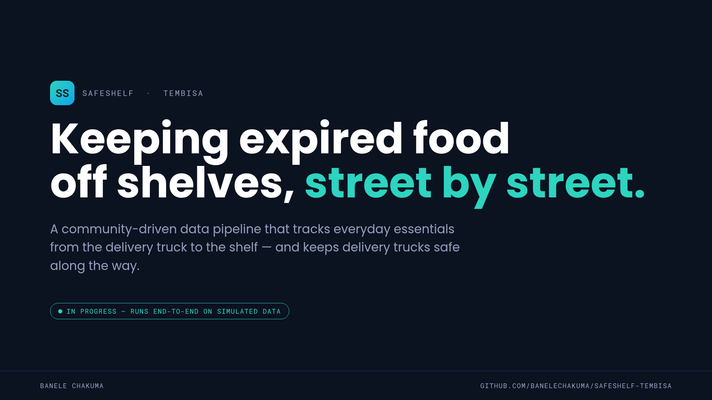
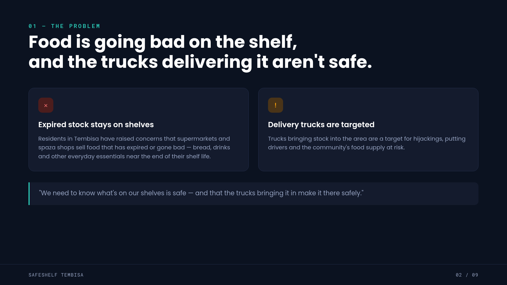
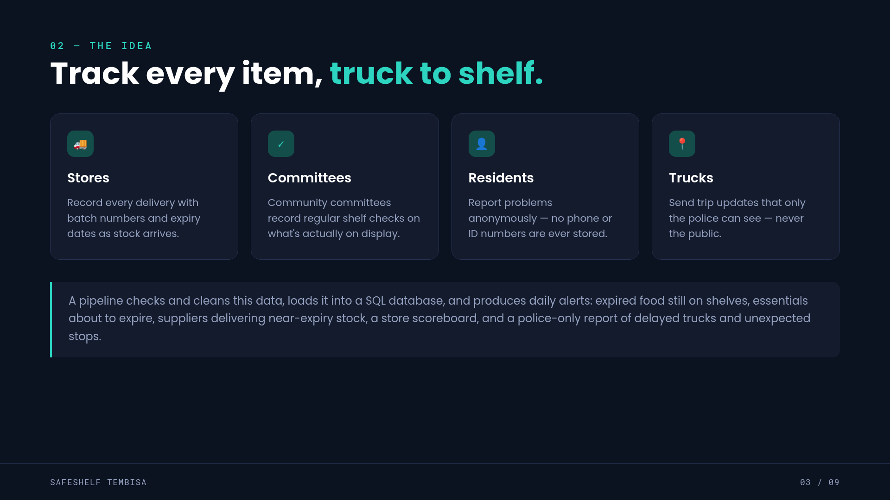
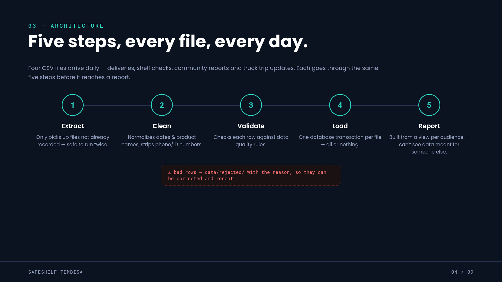
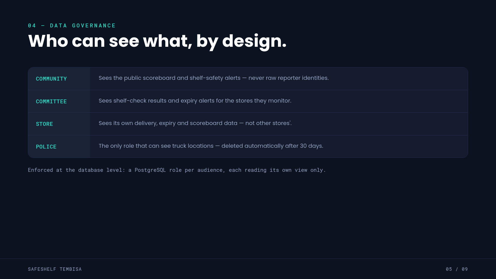
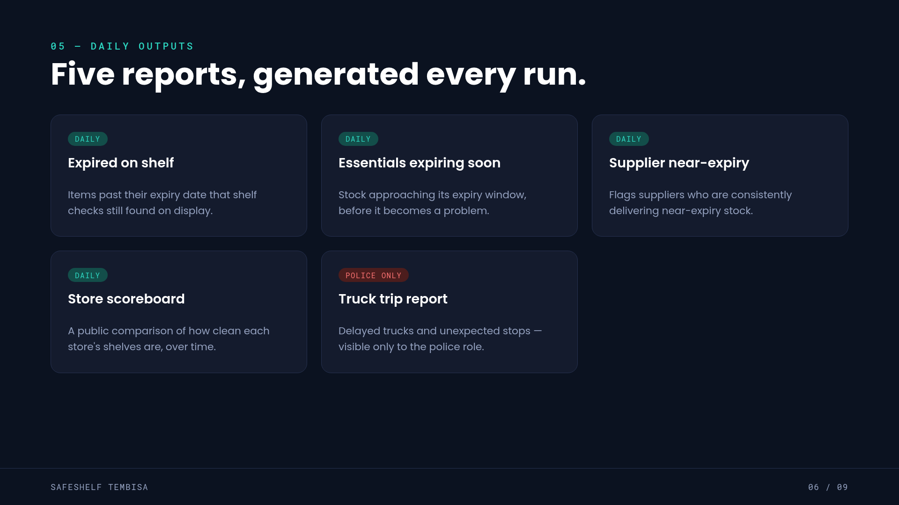
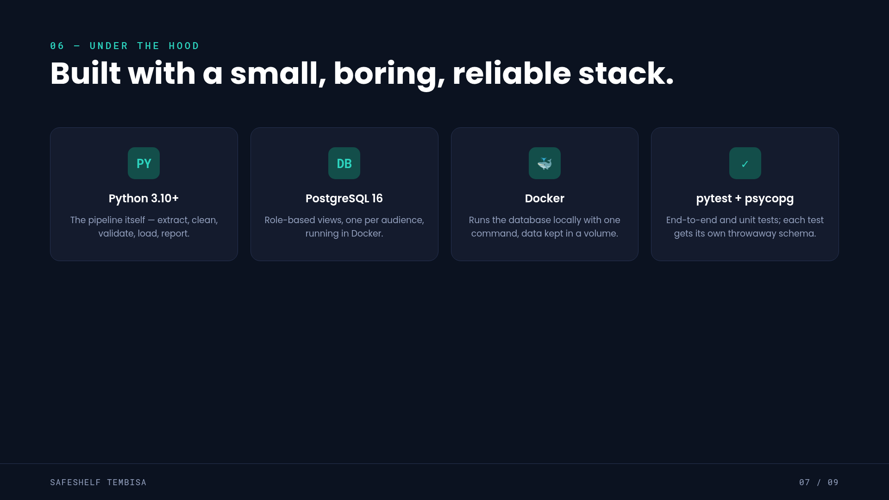
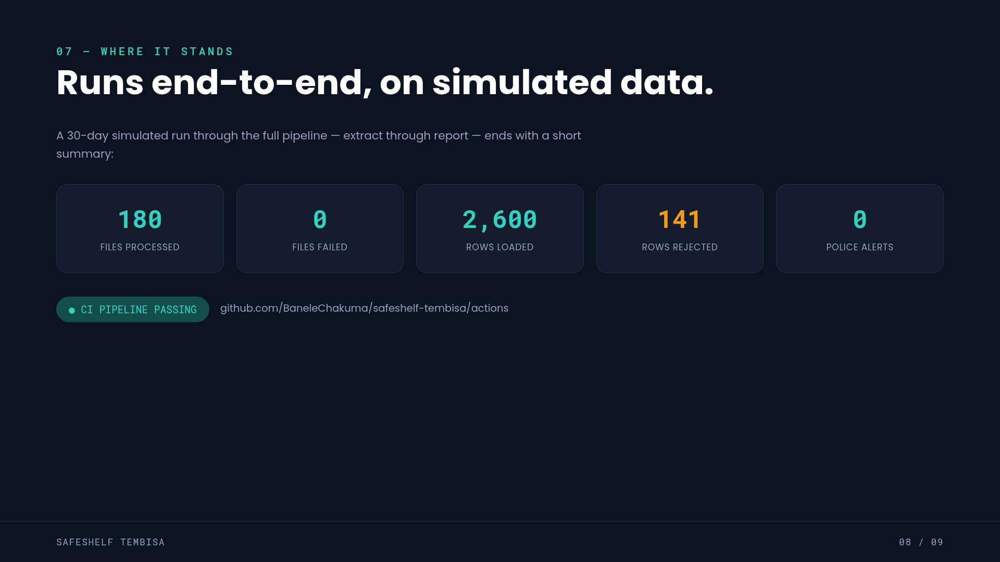

# SafeShelf Tembisa — Project Slides

A data pipeline that helps communities keep expired and spoiled food off supermarket shelves, and keeps delivery trucks safe.

---

### 1. Title

### 2. The Problem

### 3. The Idea

### 4. Architecture

### 5. Data Governance

### 6. Daily Outputs

### 7. Tech Stack

### 8. Status

